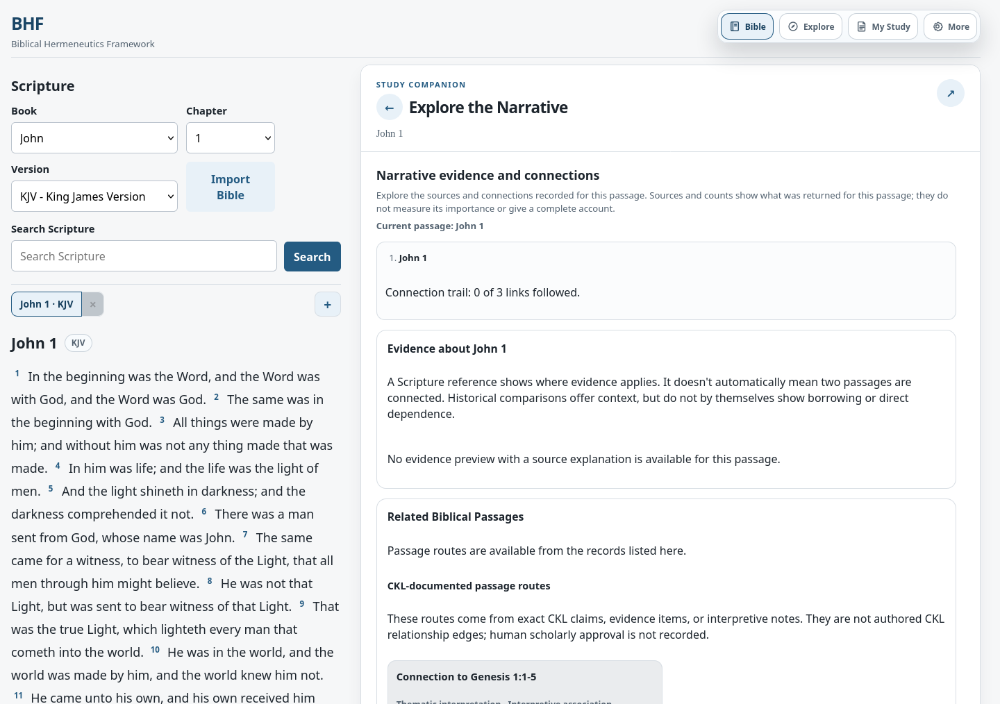
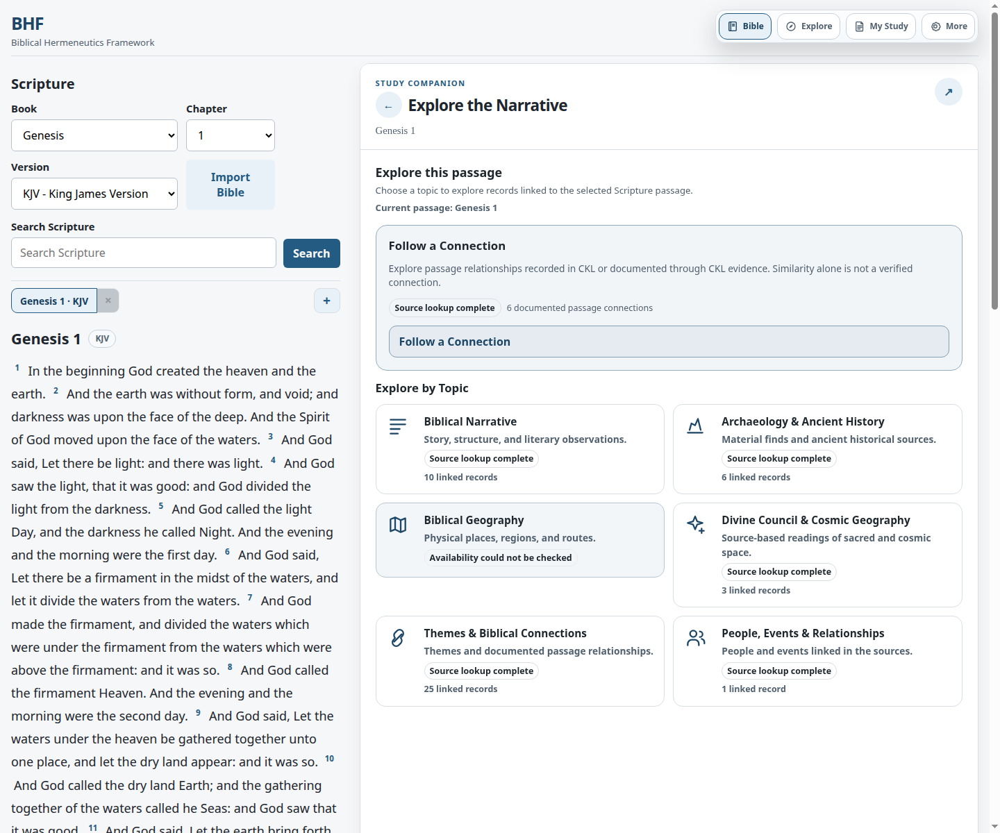
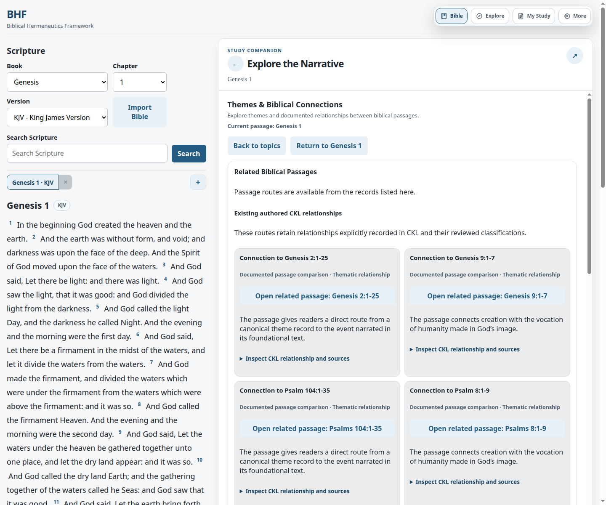
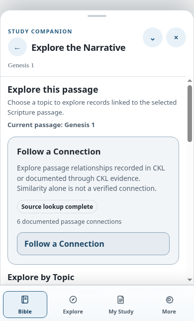

# UI-03 Reader Acceptance

This report covers the Narrative Explorer redesign on `feat/bhf-narrative-explorer-ux-ui-03`, based on UI-02 at `f4b203de`. The approved [design contract](../../superpowers/specs/2026-10-30-bhf-narrative-explorer-ui-03-design.md) and [implementation plan](../../superpowers/plans/2026-10-30-bhf-narrative-explorer-ui-03.md) use a passage-first overview and focused category views whose state is kept in Companion history. UI-03 changes the reader presentation and navigation only; the projection API and CKL research inputs remain authoritative.

## Reader flow

Opening Narrative Explorer keeps the selected passage in view and presents **Follow a Connection** plus six topic choices: Biblical Narrative, Archaeology & Ancient History, Biblical Geography, Divine Council & Cosmic Geography, Themes & Biblical Connections, and People, Events & Relationships. The overview does not include evidence inventories. Availability and counts are rendered only from returned projection state; partial and unknown remain distinguishable from a completed empty lookup.

Choosing a topic opens one focused view in the existing Companion resource host. It has a passage reference, a short description, up to two previews, bounded **Browse records** paging, expandable record/source details, **Back**, and **Return to Passage**. The active category is a bounded allowlisted Companion history value; it does not issue another passage projection request. Evidence uses the original projected record, stable identifiers, and existing passage/map eligibility rules.

Connection trails show an ordered path from origin through the recorded connection to its destination. The existing direction, relationship basis, source identifiers, review state, uncertainty, cycle protection, hop limit, breadcrumbs, and return-to-origin behavior are retained. Similarity remains separate from an established quotation, allusion, borrowing, fulfillment, or dependence claim.

## Real-reader journeys exercised

| Passage or journey | Acceptance observed |
| --- | --- |
| Genesis 1 | Opened the selected passage in the discovery view, entered a focused topic, and returned without losing the reader passage. Desktop and exact 390 px Chrome screenshots are included below. |
| Genesis 6 | Draft and human-review disclosures retain their recorded status, sources, and qualifications; no scholarly approval is inferred. |
| Exodus 3 | Biblical Geography reports partial availability from its returned records. Divine Council & Cosmic Geography remains unknown/uncheckable, with no physical map action or synthesized coordinates. **Return to Passage** retains Exodus 3:2. |
| Psalm 22 → Mark 15 | The held/unsupported candidate is not promoted to a verified passage route. No new quotation, allusion, or fulfillment label is created. |
| Jonah → Matthew | The verified route remains navigable with its recorded direction and review metadata; cancellation and return preserve the originating passage. |
| Limited or missing coverage | Empty, partial, unknown, offline, and feature-disabled states remain separate. An unknown projection is not described as an empty evidence set. |

The Exodus 3 browser journey, the Companion passage/disclosure journey, the feature-gate desktop/mobile journey, and the Companion discovery handoff browser test pass. The related NE-11D GUI set exercised Genesis 1, Jonah/ Matthew, Psalm 22 negative-route behavior, feature gating, keyboard use, mobile layout, offline state, and review disclosures. Its initial run had five stale assertions against the previous inventory UI; after updating those assertions, all five affected cases passed. The 28 unaffected cases passed in that run. This is 33 GUI cases passing across the original run and focused rerun, rather than a single 33-test invocation.

## Evidence and neighboring features

- Source identity, provenance, relationship basis, confidence/uncertainty, and human review status remain accessible from evidence detail disclosures. Draft and in-review labels reflect the recorded values.
- Biblical Geography and Divine Council & Cosmic Geography remain separate; symbolic/supernatural geography does not acquire a physical marker or generated coordinates.
- Companion history restores the passage, trail, selected category, and focus target through Back/Forward. Returning to the passage restores the original reader selection and overview.
- Updated browser checks cover the Ask BHF discovery handoff, selected passage restoration, and retired BHF Commentary reader behavior. The Tyndale browser check was skipped because the local Tyndale notes database is unavailable in this worktree; its API, evidence, and service tests passed. Retired Commentary endpoints remain HTTP 410.
- Maps/Archaeology, scripture navigation and translation comparison, notes/highlights/saved studies, and the existing reader/Companion host were not replaced or routed through a new shell.

## Accessibility and responsive checks

The overview uses semantic buttons and headings, decorative SVGs are hidden from assistive technology, focused controls retain visible focus, and evidence details use native disclosures. Keyboard and screen-reader status announcement assertions remain in the frontend and GUI regressions. At 390 px in Chrome, the view is single-column with no horizontal overflow. Desktop uses the wider two-column card layout. The Firefox mobile capture in the earlier smoke path used a 500 px viewport floor; the 390 px result is therefore taken from Chrome.

## Browser captures

**Before, John 1 desktop (UI-02):**

**After, Genesis 1 desktop and connection category:**

**After, Genesis 1 mobile at 390 px:**

John 1 before/after captures are also retained for the matched performance comparison in [the results report](02-performance-and-visual-results.md).
