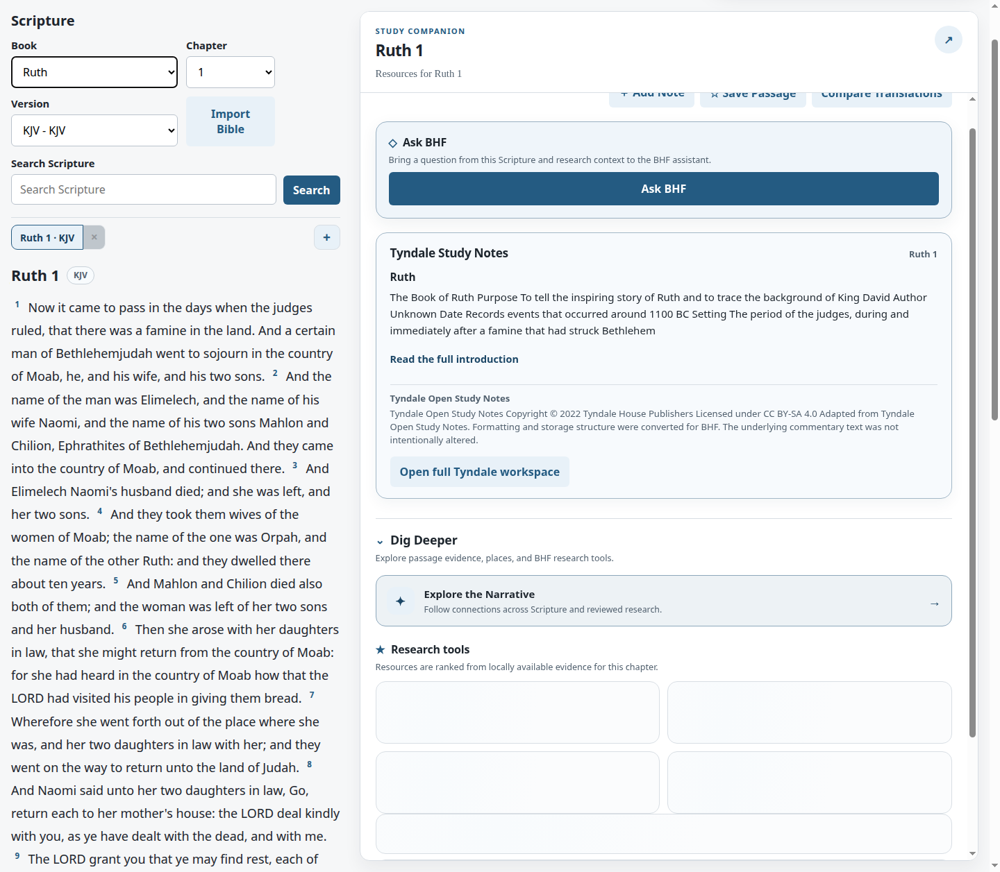
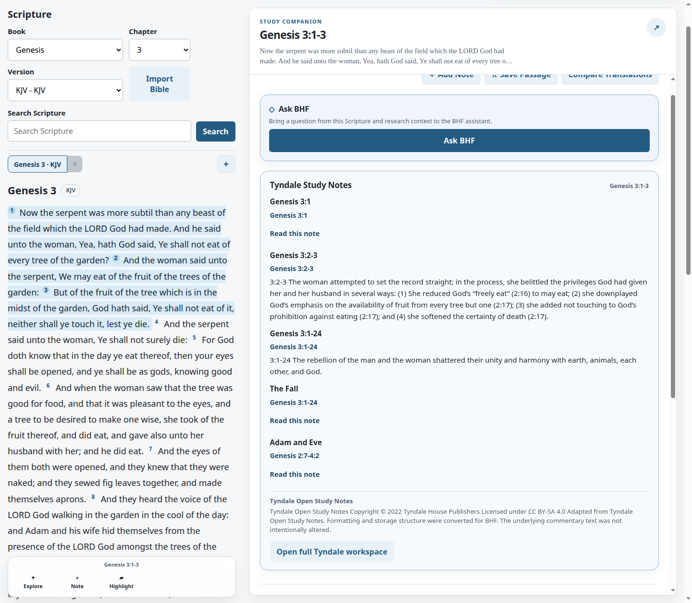
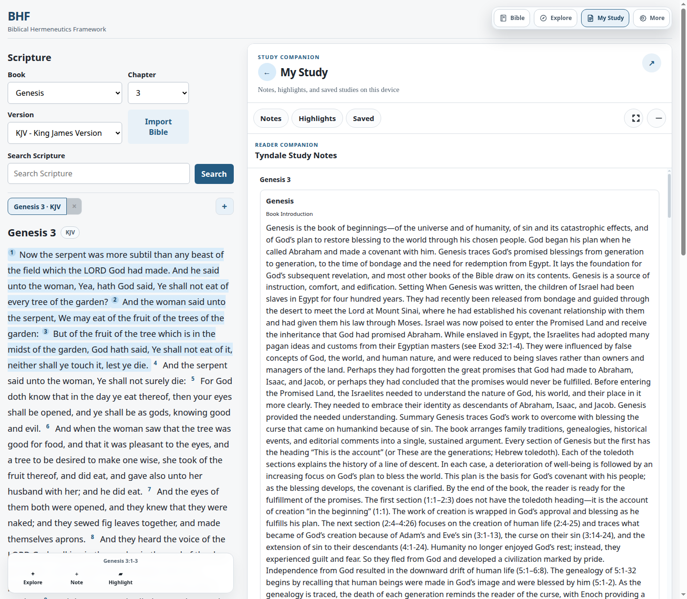
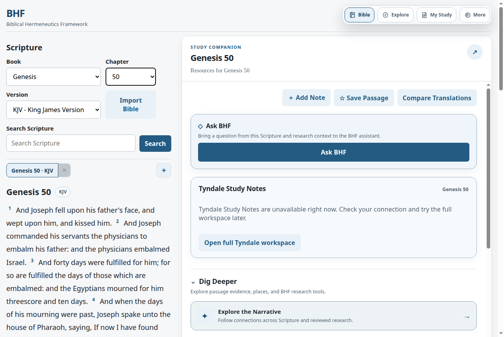
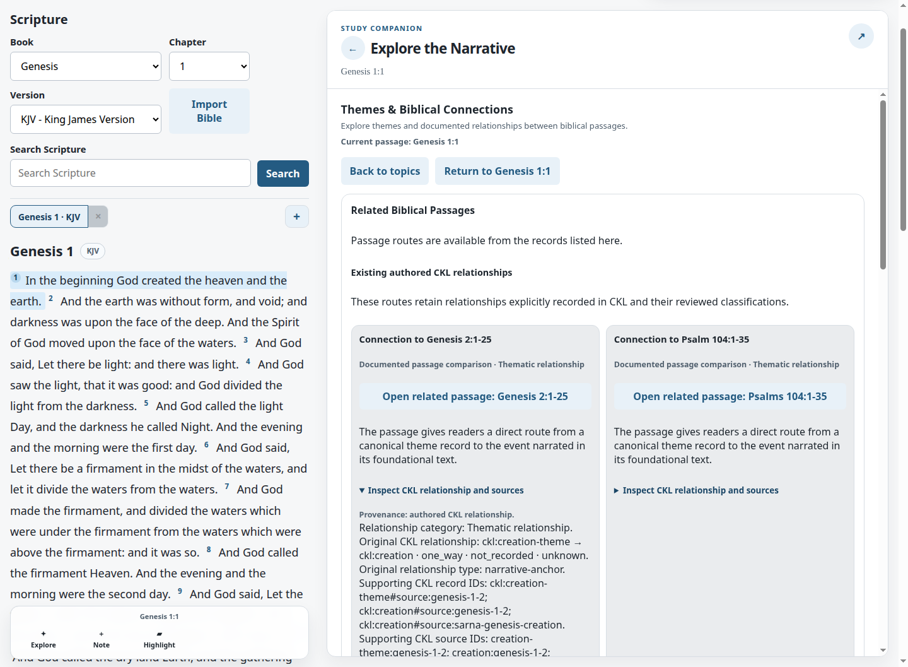
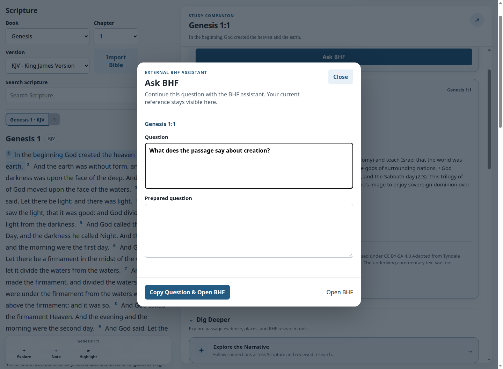

# BHF UI-04 — Integrated Reader Acceptance

**Result:** PASS for the UI-01/UI-02/UI-03 reader journeys, with release limitations recorded in [the final decision](04-final-release-decision.md).

**Repository:** `mcscwizzy/biblical-hermeneutics-framework` 
**Branch:** `test/bhf-ui04-integrated-reader-acceptance` 
**Fetched baseline:** `c44c19a708f1073e1af815a477f8c9b6701bd4ea` (`origin/master`, UI-03 merge) 
**Tested source commit:** `183fa056d1b32fc0e1a19aa0eb7115c3e23731cf` 
**Acceptance date:** 2026-10-30

This acceptance follows the [UI modernization roadmap](../../study-companion-ui-modernization-roadmap.md), the [UI-02 design](../../superpowers/specs/2026-10-30-bhf-tyndale-first-class-reader-design.md) and [implementation plan](../../superpowers/plans/2026-10-30-bhf-tyndale-first-class-reader.md), and the [UI-03 design](../../superpowers/specs/2026-10-30-bhf-narrative-explorer-ui-03-design.md), [implementation plan](../../superpowers/plans/2026-10-30-bhf-narrative-explorer-ui-03.md), and [reader acceptance](../../narrative-explorer/ui03/01-reader-acceptance.md). UI-03 was already merged into `master` at the fetched baseline before this branch was created.

## Reader journeys

| Journey | Result | Browser evidence |
| --- | --- | --- |
| Genesis 1, no verse selected | The live Tyndale database returned the Genesis book introduction and published summary. The card showed the source attribution and CC BY-SA 4.0 disclosure; the full text expanded with the native disclosure control. | [Genesis introduction](screenshots/ui04-tyndale-genesis1-introduction-desktop.png) |
| Genesis 1:1 and full Tyndale workspace | Selecting Genesis 1:1 replaced the introduction with only notes whose anchors match the selection. The full workspace opened on the Commentary tab, showed the same chapter records and license, and returned to Genesis 1:1. | [Full workspace](screenshots/ui04-tyndale-genesis1-full-workspace.png) |
| Explore from Genesis 1 | In one actual Chrome session, the reader opened the Narrative Explorer after the Tyndale workspace, displayed all six topics, entered Themes & Biblical Connections, inspected the recorded relationship/source disclosure, and returned to Genesis 1:1. | [Integrated focused connection and source details](screenshots/ui04-genesis1-integrated-explorer.png); [Explorer overview](screenshots/ui03-discovery-desktop.png) |
| Ask BHF from Genesis 1 | The same browser session returned to the passage overview and opened Ask BHF. The modal retained Genesis 1:1 and the entered question. The handoff GUI cases also verify inline empty-question validation, selection updates, one modal, and focus restoration. | [Integrated Ask BHF handoff](screenshots/ui04-genesis1-integrated-ask.png); passing GUI cases listed in [test results](03-performance-and-integrity.md#test-results). |
| Ruth 1 and later chapters | The live database showed Ruth’s own introduction and did not show the Genesis introduction. Genesis 3 chapter notes, a single verse, and a 1–3 range matched only records whose anchors overlap the current chapter or selected verses. | [Ruth introduction](screenshots/ui04-tyndale-ruth1-introduction-desktop.png), [Genesis 3 chapter notes](screenshots/ui04-tyndale-genesis3-chapter-notes-desktop.png), [range selection](screenshots/ui04-tyndale-genesis3-range-selection-desktop.png) |
| Genesis 6 | The reviewed browser journey exposed evidence provenance, recorded interpretive qualifications, draft status, and human-review disclosures. No draft was presented as approved scholarship. | Covered by the passing Genesis 6 draft-detail GUI cases. |
| Exodus 3 | Biblical Geography and Divine Council & Cosmic Geography remained distinct. The physical geography view exposed its recorded sources and eligible map links; the cosmic category remained unknown/uncheckable, with no coordinates or map action invented. Return-to-passage restored Exodus 3:2. | Covered by the passing Exodus 3 geography/cosmic-category GUI journey. |
| Jonah and Matthew | The verified Jonah–Matthew connection remained navigable with its recorded direction and source/review details. Companion history returned to the originating passage. | Covered by the passing real-CKL Jonah/Matthew handoff and Matthew-first browser journeys. |
| Psalm 22 and Mark 15 | The held or unsupported candidate was not exposed as a verified route. Negative controls returned no handoff; no theological relationship was manufactured. | Covered by the passing Psalm 22 negative-route browser cases. |
| Limited-data passages | Completed empty, partial, unknown, unavailable, feature-disabled, and offline states remained distinguishable. The actual offline Tyndale cache-miss test displayed the explicit connection-unavailable message. | [Offline Tyndale state](screenshots/ui04-tyndale-offline-unavailable.png); feature/offline GUI and frontend checks passed. |

The full Narrative Explorer UI-03 acceptance remains applicable: its six categories, provenance and relation direction, connection trails, source disclosures, and return-to-passage behavior were exercised by its real-browser journey tests and screenshots. UI-04 reran the integrated browser regressions and fixed the only implementation defect found in the new end-to-end Tyndale path.

## Tyndale source provisioning

The officially supported, checksum-pinned Tyndale Open Study Notes archive was provisioned outside the repository and imported into an isolated local browser-test database. Archive SHA-256: `7b4d5ae088449d5a6925170c4b89b978acee2f78f73dc6b8a278fa948a7e8498`. Database SHA-256: `2652edde56b22cf22628ced0da7dd81d7668c305ce17581a5a817aa97765e17f`.

`framework.commentary check-tyndale` verified SQLite integrity, 17,478 entries and 17,478 anchors, with no orphaned, unmapped, unrecognized, or unanchored entries. The response reported Tyndale House Publishers attribution and CC BY-SA 4.0. The source archive and database stayed outside Git.

The actual-data browser run checked Genesis 1 and Ruth 1 introductions, exact note matching for Genesis 1:1 and Genesis 3:1–3, rapid chapter changes through Genesis 6, a restored Genesis 3 range, and the full workspace. A separate fresh Chrome session cleared the API cache, emulated offline, and requested uncached Genesis 50; the card showed “Tyndale Study Notes are unavailable right now.” The page had no active service-worker controller in that session, so this probe verified the browser’s direct offline failure state. Service-worker cache behavior was covered separately by the passing frontend and GUI offline tests.

## Focused correction

The real-reader check found that **Open full Tyndale workspace** selected the Commentary tab while the My Study dock section was hidden. The tab state changed, but the reader could not see the workspace. The button now activates My Study before opening Commentary. A frontend regression asserts the navigation order; the GUI regression clicks the actual contextual-card button and verifies the visible pane and restored note. No Tyndale source data or schema changed.

## Browser captures

**Ruth introduction and Genesis 3 range matching:**

**Restored session and unavailable state:**

**Single-session Genesis 1 handoff:**

See [responsive and navigation acceptance](02-accessibility-mobile-and-navigation.md) and [performance, integrity, and test results](03-performance-and-integrity.md) for the remaining evidence and limitations.
