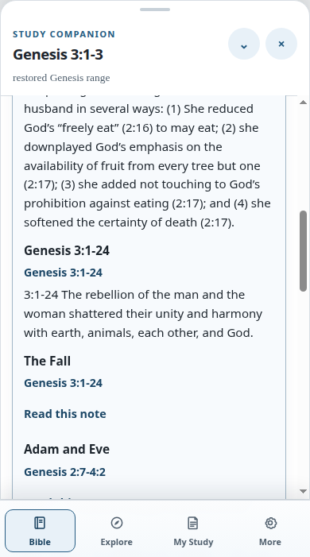
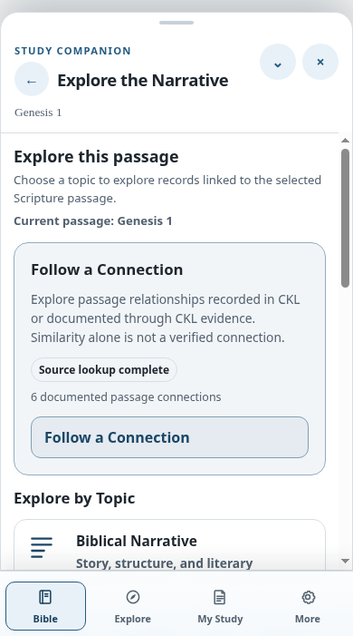

# BHF UI-04 — Accessibility, Mobile, and Navigation

**Result:** PASS for responsive layout, keyboard navigation, semantic controls, focus behavior, and browser history. A screen reader was not available for spoken-output testing; DOM semantics and live-region updates were inspected and exercised.

**Tested source commit:** `183fa056d1b32fc0e1a19aa0eb7115c3e23731cf` 
**Browser:** isolated Selenium Chrome 155; actual mobile viewport tests used 390 CSS pixels.

## Responsive review

| Surface | Widths exercised | Result |
| --- | --- | --- |
| Bible reader and settings sheet | 320, 375, 390, 430, 768, 1024, 1366, and 1440 px | No horizontal document overflow in the responsive GUI checks. |
| Narrative Explorer overview, category, and actions | 320, 390, 768, and 1440 px | Cards and actions fit; mobile view stays single-column; controls remain reachable. |
| Tyndale contextual card | 390, 768, and 1440 px in the GUI check; live notes also inspected at 390 px | No horizontal overflow; content remains readable; selected passage and notes stay synchronized. |
| Companion sheet/drawer transitions | Mobile open, collapse/expand, dock changes, map/workspace transitions, and desktop docking | Existing GUI transition checks passed without trapping the reader in a nested scroll area. |

The 390 px capture below comes from an actual headless Chrome viewport and shows live Tyndale notes with the Genesis 3:1–3 selection. The carried-forward Explorer mobile capture is also 390 px.

## Keyboard, focus, and history

- Keyboard-only GUI checks cover Explorer discovery, focused categories, the connection view, passage return, and Escape across 320, 390, 768, and 1440 px; all four cases pass after the layered Escape assertion was aligned with the approved history contract.
- Escape from a focused category first returns to the Explorer overview and focuses its primary heading. A second Escape exits Explorer and restores focus to the opening action. This records two history layers rather than skipping the overview.
- Browser Back/Forward checks cover the current passage, Explorer category and evidence disclosures. Return-to-passage restores the original selection and Companion history state.
- Tyndale’s `
/
` control is keyboard-operable. Updating notes does not move focus from the selected verse. The workspace button now reveals the parent My Study section before focusing the Commentary tab.
- Ask BHF modal tests cover focus containment, Escape-to-close, trigger focus restoration, exact current-selection handoff, and inline empty-question validation.
- Sheet and drawer tests cover touch and non-gesture controls, breakpoint/orientation changes, reader settings, map navigation, and closing mobile map surfaces.

The original UI-03 Escape assertion expected one Escape to leave Explorer entirely. Browser inspection showed the implemented and documented history behavior: the first Escape returns from the focused view to the Explorer overview; the second exits Explorer. The acceptance assertion now verifies both layers and focus targets. This was a test-contract correction, not a product behavior change.

## Labels and announcements

The browser DOM exposes semantic heading hierarchy, named buttons and sections, native disclosure controls, and polite live-region status updates for Explorer and Tyndale changes. The Tyndale card’s status region has `role="status"` and `aria-live="polite"`; the full Commentary panel is named “Tyndale Study Notes.” Explorer’s route/status region and passage topic navigation also have accessible names. Visible focus is retained through keyboard history changes.

No assistive-technology runtime was available, so this acceptance does not claim NVDA, JAWS, VoiceOver, or TalkBack spoken-output verification. The screen-reader-oriented semantics and status text were verified in the DOM and browser tests.

## Findings

No horizontal overflow, inaccessible action, nested-scroll trap, unexpected focus jump, or reader-scroll interruption was found in the tested flows. Actual screen-reader output remains unverified and is recorded as an environmental limitation in the final decision.
