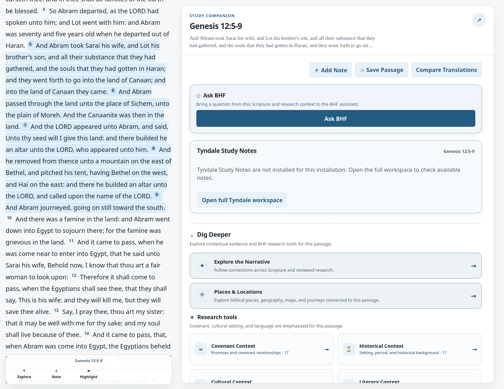
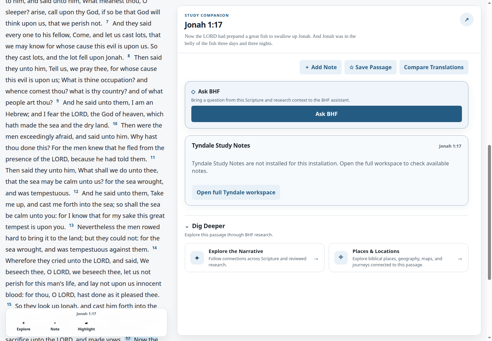
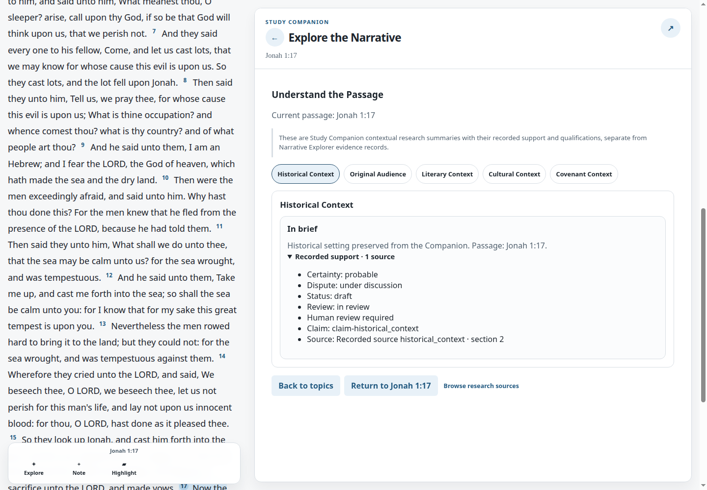

# BHF UI-07 — Reader-First Research Consolidation

## UX change

The passage overview now leads with personal study, Ask BHF, and the selected
passage's Tyndale Study Notes. Dig Deeper ends in two compact choices:
**Explore the Narrative** and **Places & Locations**. The research inventory
no longer appears on the normal overview; Explore BHF keeps its independent
browse catalog.

Explore the Narrative keeps its six categories and prominent **Follow a
Connection** path. **Understand the Passage** opens one of five existing
Companion summaries at a time. Each summary retains its recorded support,
certainty, dispute and review status, and source identity. A secondary
**Browse research sources** view links to the existing CKL, Maps, archaeology,
and passage research routes. The contextual summaries remain identified as
Companion research, separate from Narrative Explorer evidence records.

Feature-disabled installations keep concise contextual and source links inside
the Companion. The passage action row, reader Lexicon flow, full Tyndale
workspace, Places & Locations, APIs, and standalone libraries remain available.

## Browser screenshots

| UI-06 before | UI-07 overview | UI-07 focused context |
| --- | --- | --- |
|  |  |  |

At the 390 px Chrome viewport, the focused view keeps all five topic choices
within the available width and the overview keeps its two discovery entries
stacked. [Mobile overview](screenshots/after-overview-mobile-390.png) ·
[Mobile context view](screenshots/after-understand-passage-mobile-390.png).
The focused-view captures use deterministic browser fixture records to expose
the existing support and attribution fields; the production view renders the
matching Study Companion context response without synthesizing summary text.

## Verification

The enabled Chromium journey covered both Dig Deeper entries, all six
Narrative Explorer categories, the five context topics, source identity and
recorded support, connection trails, source browsing, selection changes,
Back/Forward, Escape, focus restoration, return-to-passage behavior, and the
CKL handoff. Feature-disabled and offline browser
coverage confirmed the fallback routes. At 390 px, Chromium reported no
horizontal overflow and at least 4.5:1 contrast for the visible navigation and
context text. `npm test` passed all 17 frontend test files. The targeted Python
suite passed 87 tests and four subtests, with 55 skipped. Framework validation
passed for all 94 modules. CKL validation found 687 valid objects, zero errors,
and 14 warnings in the unchanged library.

No CKL, Tyndale data or licensing, Narrative Explorer relationship semantics,
retired Commentary behavior, or production deployment configuration was
changed.
