# UI-07A Contrast Polish Report

## Summary

UI-07A corrects the dark-theme button cascade that made the Dig Deeper and Narrative Explorer cards difficult to read. The affected card surfaces now use BHF's semantic surface tokens; headings, descriptions, metadata, statuses, controls, hover states, and keyboard focus use explicit theme-aware foregrounds and accents. Light and dark themes both retain their existing layout and behavior.

The implementation changes only `bhf_web/static/styles/companion.css`, this report, screenshots, and the rendered browser regression test. It does not change UI-07 navigation, passage retrieval, CKL evidence, research provenance, Places & Locations data, Tyndale, Ask BHF, personal study, browser history, routes, or production configuration.

## Styling root cause

The rendered dark-theme appearance came from the global button rules in `bhf_web/static/styles/utilities.css`:

- `html[data-theme="dark"] button` sets `color: #07101a` and `background: var(--accent)`.
- Its hover and focus rules change the background to `var(--accent-strong)`.
- The global `button` rule also supplies bold text weight.

The page theme tokens in `bhf_web/static/styles/layout.css` were appropriate. The failure was in how component declarations competed with the global button selectors. The single-class `.narrative-explorer-category-card` background rule lost to the higher-specificity dark button rule, leaving light title and muted description text on an accent-blue fill. The Dig Deeper card surface rule was more specific and kept its neutral background, but it did not set a foreground on the card itself; the card inherited the global dark button's near-black foreground. Hover and focus also picked up the global accent-strong fill.

The stylesheet import order was not the root cause: `bhf_web/static/style.css` imports `utilities.css` before `companion.css`, but the global dark selector has greater specificity than the original component selectors. Computed opacity was `1`; opacity and translucent layering did not cause the failures. The semantic tokens themselves were not the source of the problem.

Before the fix, rendered dark-mode measurements included:

- Dig Deeper title foreground `#07101a` on surface `#18212a`: **1.17:1**.
- Narrative topic title on accent `#7cb7e6`: **1.82:1**.
- Narrative topic description and count on that accent surface: as low as **1.02:1**.
- Hovering the topic card changed its surface to accent-strong `#9cc8ef`, with title and description contrast still below **1.5:1**.

The browser test recorded computed values and matched CSS declarations using Chrome DevTools Protocol before the CSS change. It covers `.narrative-explorer-entry`, `.companion-places-locations-entry`, and `.narrative-explorer-category-card`; the resulting cascade showed the global dark button rule alongside the component declarations.

## Before and after screenshots

Screenshots are captures from the real Chrome browser at the stated CSS viewport widths. Desktop screenshots are 1440 px wide; mobile screenshots use Chrome's 390 × 844 px mobile emulation.

### Dark theme — desktop

| Before | After |
| --- | --- |
| 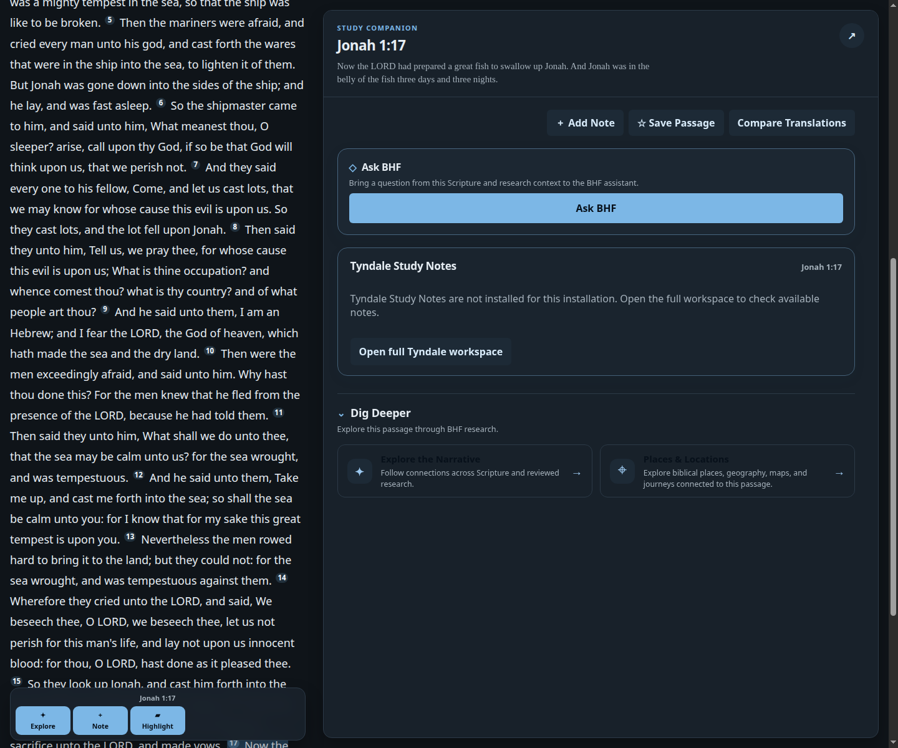 | 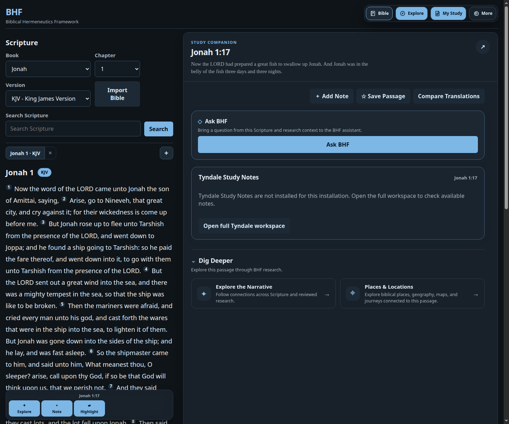 |
| 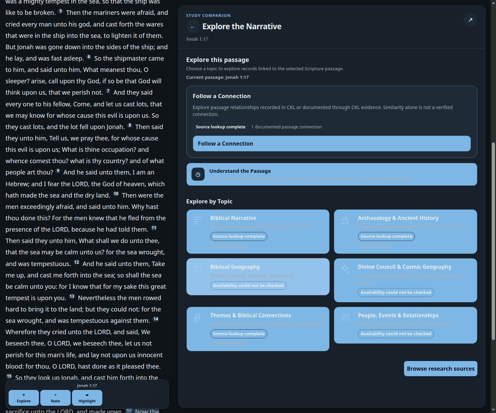 | 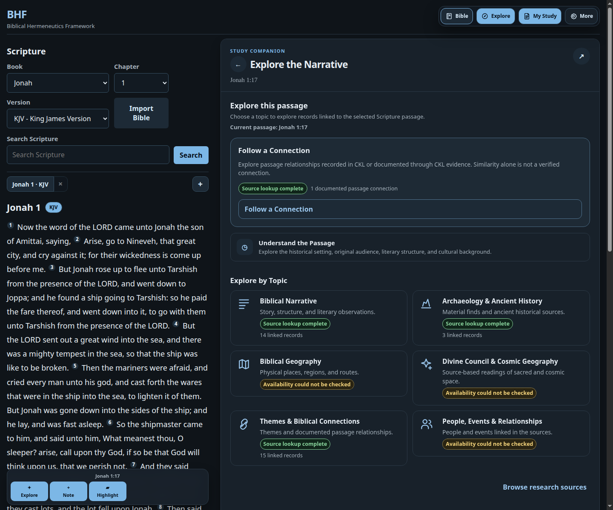 |

### Light theme — desktop

| Before | After |
| --- | --- |
| 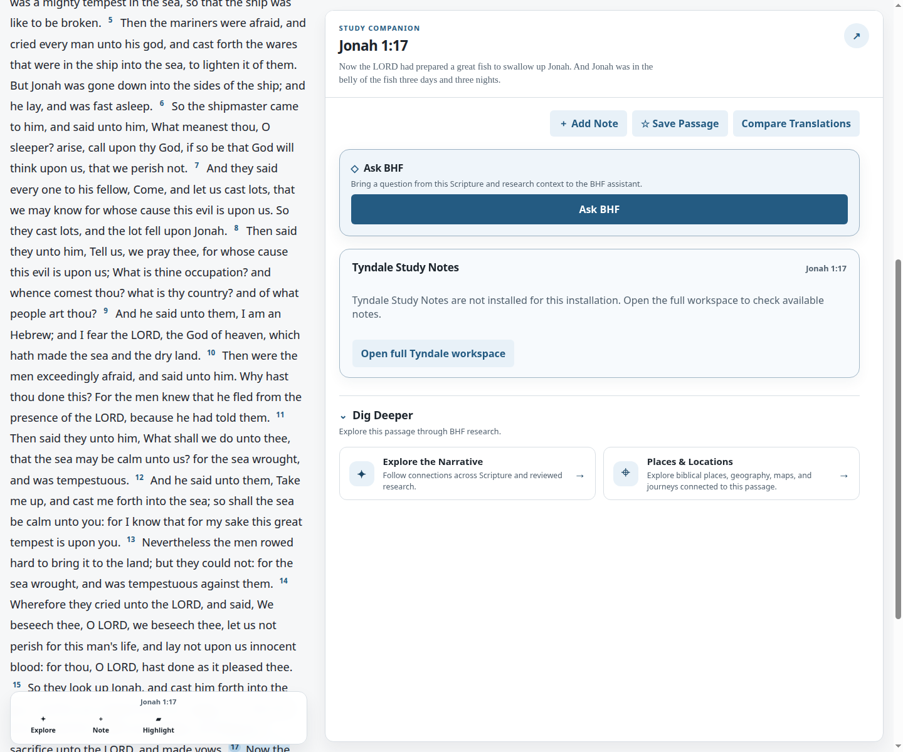 | 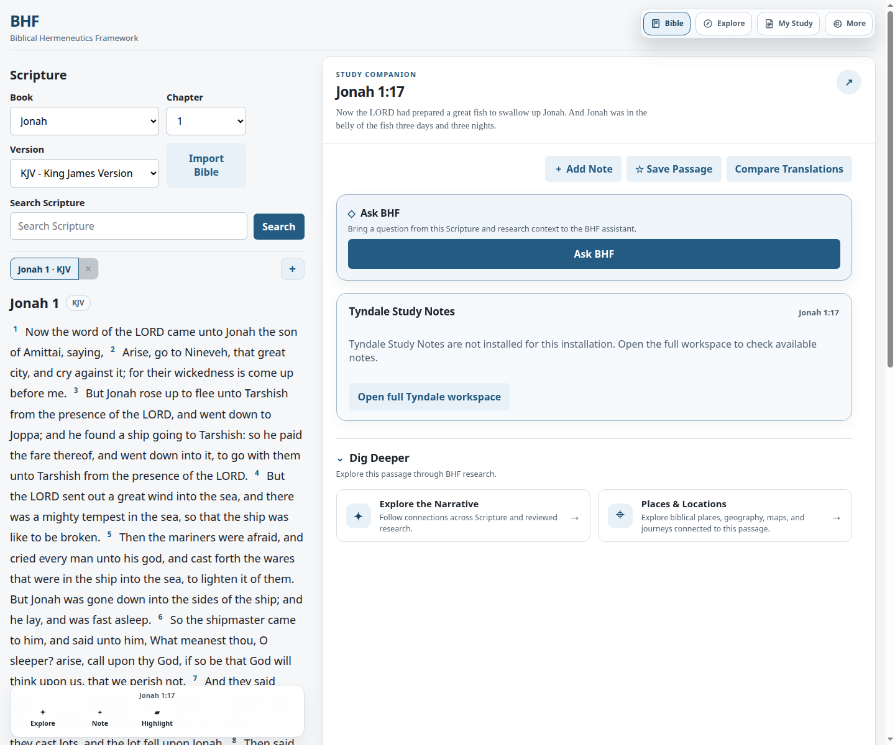 |
| 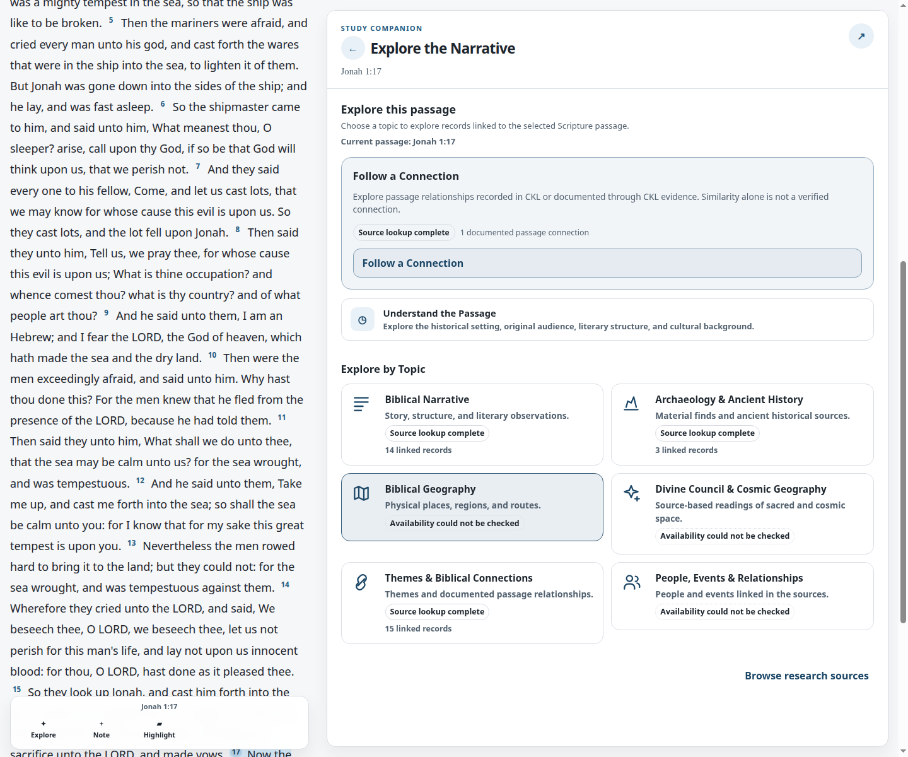 | 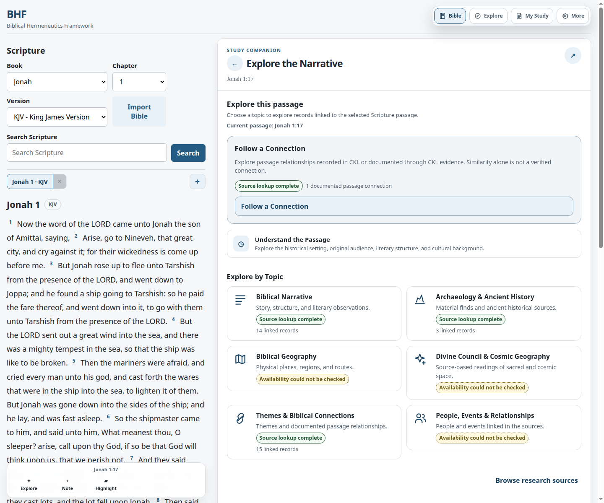 |

### After — Chrome mobile at 390 × 844 px

| Dark theme | Light theme |
| --- | --- |
| 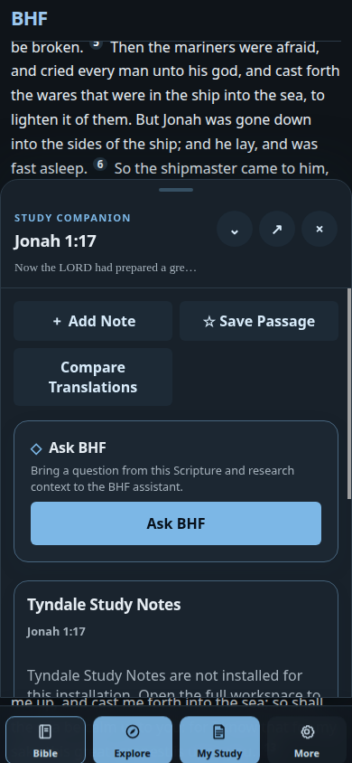 | 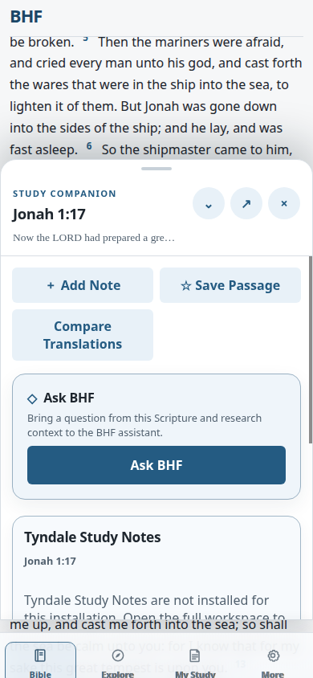 |
| 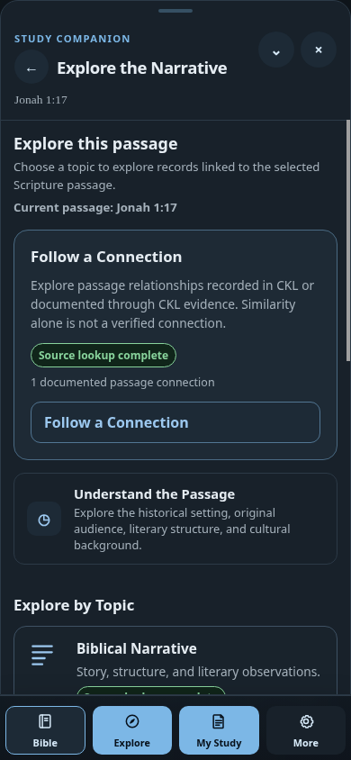 | 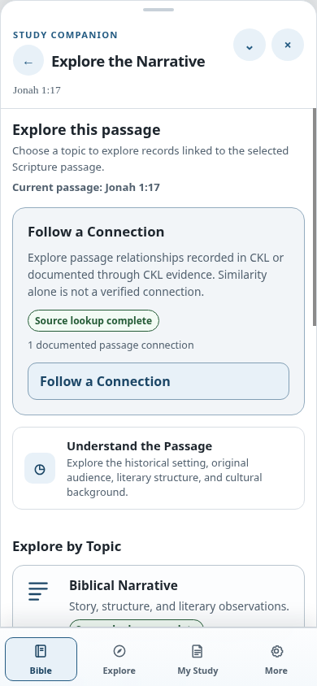 |

## Rendered contrast results

Ratios below were measured in Chrome from computed foreground and background colors, compositing translucent ancestor surfaces. The browser checks included the actual rendered buttons, topic titles and descriptions, status badges, linked-record metadata, Browse research sources, source-navigation buttons, hover treatments, and disabled “No records available” control.

| Representative text | Dark | Light |
| --- | ---: | ---: |
| Dig Deeper title | 13.78:1 | 15.50:1 |
| Dig Deeper description | 7.45:1 | 6.37:1 |
| Narrative Explorer topic title | 13.78:1 | 15.50:1 |
| Narrative Explorer topic description | 7.45:1 | 6.37:1 |
| Follow a Connection | 8.30:1 | 8.69:1 |
| Source lookup complete | 9.10:1 | 7.57:1 |
| Partial results | 10.50:1 | 6.23:1 |
| Availability could not be checked | 10.50:1 | 6.23:1 |
| No linked records returned | 7.56:1 | 6.13:1 |
| Linked-record count | 7.45:1 | 6.37:1 |
| Browse research sources | 9.24:1 | 9.93:1 |
| Back to topics / Return to Passage | 11.96:1 | 6.35:1 |
| Disabled “No records available” | 7.56:1 | 6.13:1 |
| Minimum status-border contrast against card surface | 7.45:1 | 6.37:1 |
| Minimum sampled text contrast, including category hover | **6.68:1** | **5.82:1** |

All sampled normal text exceeded WCAG AA's 4.5:1 target. Status borders exceeded 3:1 against their adjacent card surfaces. Keyboard focus was exercised on Dig Deeper cards, topic cards, and both source-navigation controls; each retained a visible 3 px outline with at least 3:1 contrast. Hovered Dig Deeper cards, Follow a Connection, and topic cards also remained above 4.5:1 for sampled text.

The status styles distinguish available, partial, unknown, and not-represented outcomes. Available uses the success treatment; partial and unknown use warning colors with different dashed and dotted borders; not-represented uses a neutral treatment. Unknown and not-represented fixture records display no linked-record count, so unknown availability is not presented as zero evidence.

## Responsive verification

Chrome measured both themes at 1440, 768, and 390 CSS px:

| Viewport | Dig Deeper | Narrative Explorer categories | Horizontal overflow / clipped descriptions |
| --- | --- | --- | --- |
| 1440 px | 2 columns | 2 columns | None / none |
| 768 px | 2 columns | 1 column at the existing breakpoint | None / none |
| 390 × 844 px mobile | Stacked | 1 column | None / none |

At 390 px, Dig Deeper cards fit within 360 px content columns. All six topic cards fit the viewport width; descriptions were not clipped. The resource host had zero horizontal overflow at all tested widths, and document horizontal overflow was never positive. Existing responsive breakpoints and card navigation remain unchanged.

## Regression results

- `npm test`: **17 passed, 0 failed**.
- Final affected browser selection, including all three previously unresolved cases: **11 passed, 0 failed**. This covers rendered contrast in both themes, status and focus states, desktop/tablet/390 px Chrome mobile layout, Companion locations, reader-first behavior, and Narrative Explorer feature-gate behavior.
- Final isolated branch reruns: each previously unresolved case **1 passed** (`19.12s`, `18.40s`, and `30.55s`, respectively).
- `git diff --check`: passed.

### Baseline comparison and test corrections

The three original cases were run separately on a clean detached checkout of base commit `b63f717d896cc8cc727d60dca2e90f66081a4778` and on the UI-07A branch, using the same headless Chrome configuration (`156.0.8078.80`) and repository browser fixtures. The offline-cache and projection-order failures reproduced individually on the base; the feature-flag failure was order-dependent and reproduced when the enabled NE fixture ran before the disabled overview test. None was a UI-07A CSS regression.

| Case | Clean base and pre-correction branch result | Root cause | Final branch result |
| --- | --- | --- | --- |
| `test_feature_disabled_overview_keeps_compact_context_and_source_fallback` | Isolated: pass on base (**41.52s**) and branch (**19.10s**). In the ordered combined run, the disabled case failed after the enabled NE fixture ran first. | Both session fixtures were named `base_url`. The nested NE fixture also left `BHF_NARRATIVE_EXPLORER_ENABLED=1` in the process environment; the parent fixture then created or reused the wrong runtime configuration. This was test-fixture isolation, not app behavior. The parent fixture now explicitly snapshots its disabled app, and the enabled tests use a separate `ne11d1_base_url`. | Isolated: pass (**19.12s**); combined selection: pass. |
| `test_feature_disabled_context_fallback_explains_offline_lookup` | Failed on base and branch while waiting for the context record to become `error`. | A prior Companion context response could be returned from the browser's IndexedDB or service-worker cache, so the offline fixture did not guarantee an uncached network failure. The test now clears only the matching IndexedDB response, bypasses service-worker replay for the offline request, and verifies `navigator.onLine === false`. Its error-state assertion remains intact. | Isolated: pass (**18.40s**); combined selection: pass. |
| `test_controlled_empty_projection_has_no_actions_and_recovers` | Failed on base and branch waiting for the intercepted projection before the UI action that starts that request. | The request wait preceded the Narrative Explorer click. After correcting that order, a second stale assumption expected a `.companion-discovery-card` action for Jonah 1:17, which has no source-grounded journey card. The test now verifies the activated empty projection and its disabled/no-route state, then verifies recovery through the current “Follow a Connection” route and the Matthew 12:40 handoff. Application behavior and research data were not changed. | Isolated: pass (**30.55s**); combined selection: pass. |

Baseline timings vary with the temporary test server and startup, but each test's pass/failure classification was reproduced. The ordered combined failure for the disabled overview also reproduced on the clean base when the enabled Narrative Explorer fixture ran first.

### Release recommendation

Recommend UI-07A for release readiness: the final affected browser gate and frontend suite pass, and all three prior failures were traced to test fixture isolation, browser cache setup, or stale test assumptions. The changes in this gate are limited to tests and fixtures; CSS contrast improvements and UI-07 behavior remain unchanged.

## UI-07 and research boundaries

UI-07's reader-first layout, existing two-column and mobile card layouts, topic names and categorization, passage-selection handoff, and navigation controls remain unchanged. Changes are limited to presentation styles and browser verification. Passage retrieval, CKL evidence, research source identities, provenance, relationship semantics, Places & Locations data, Tyndale integration, Ask BHF, personal study, browser history, and routing were not modified.
